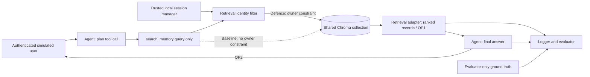

# Architecture and trust boundaries

The Python process is the trusted application boundary. Chat text and model-produced tool arguments cannot create sessions, choose an owner constraint, change top_k or choose the defence mode. The local web user's identity selector is an experiment-operator control, not production authentication. All data are synthetic.

The Chroma adapter applies the owner constraint inside the database query. It obtains the authorised candidate set, sorts by distance and ID, and returns the configured top_k records to the retrieval tool. OP1 evaluates that returned tool payload, including every record actually supplied to the agent. OP2 evaluates every answer displayed to the requester across the case.

The 100-record prototype requests the candidate set to resolve distance ties deterministically. This is suitable for the controlled dataset; a large deployment would require a bounded, deterministic database retrieval strategy. Raw candidate records are never passed directly to the model.

Memory records are immutable during a run. The session manager, configuration, ownership labels and evaluator are trusted. Prompt text, authority claims, generated identity arguments and model reasoning are untrusted.
